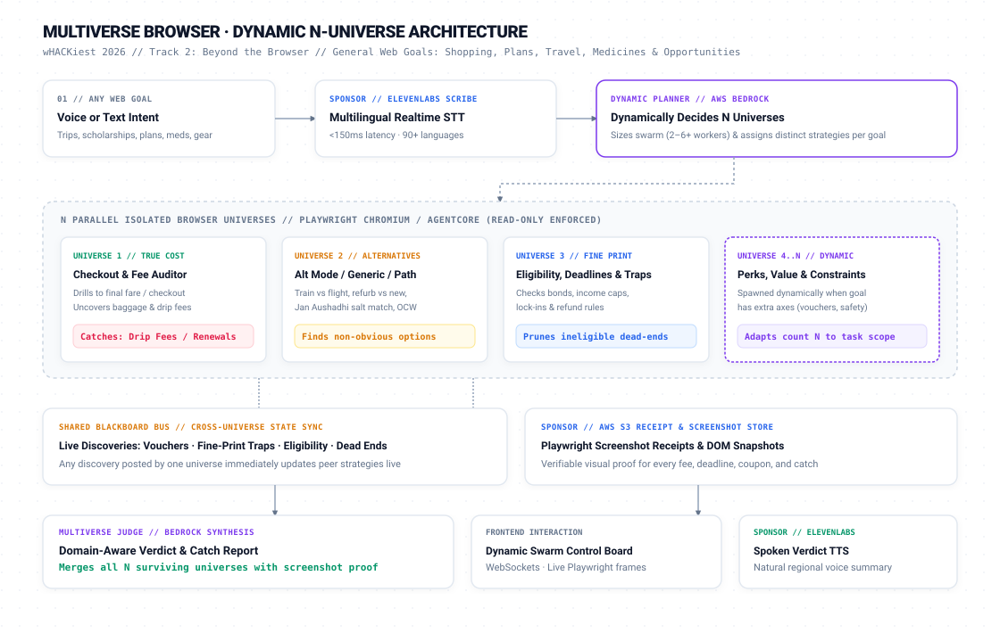

# Multiverse Browser
> One goal, many universes, one verdict you can trust.

**wHACKiest 2026** · **Track 2: Beyond the Browser (Reimagine How We Use the Web)**  
*Team CodeRIT · Ramaiah Institute of Technology*

---

## 1. The Real Problem

Online comparison is fundamentally broken:

1. **Listed Price ≠ Checkout Price**: Traditional aggregators (Google Shopping, PriceSpy, BuyHatke) only index surface listing prices. They never proceed to the checkout step, completely missing mandatory handling charges, surge fees, and payment surcharges.
2. **Deceptive Design (Dark Patterns)**: A 2025 LocalCircles audit found that **97% of leading Indian e-commerce platforms use at least one dark pattern**. The most pervasive is **drip pricing** (where fees are incrementally injected during checkout) and **fabricated MRPs** (inflating the anchor price to display false 60%+ discounts).
3. **Linear Agent Bottlenecks**: Contemporary single-agent browser tools (AutoGPT, Operator, Browser Use) execute sequentially down a single search path. If an agent gets stuck in a captcha or explores a suboptimal retailer, the user waits minutes for a mediocre outcome.

---

## 2. The Solution: Parallel Heuristic Swarm

Instead of a single browser session or 15 open tabs, **Multiverse Browser** takes one high-level intent and forks it into four parallel, isolated browser universes:

* **Universe 01 (Budget / Landed Cost)**: Navigates through product listings directly to checkout to measure true landed cost (Base + Shipping + Convenience Fees - Discounts).
* **Universe 02 (Voucher Scraper)**: Scours promotional banners, unlisted markdown footers, and secret member codes.
* **Universe 03 (Trust & Authenticity)**: Audits manufacturer warranty terms, seller ratings, and checks claimed MRPs against verified manufacturer indices to flag fake discounts.
* **Universe 04 (Value Matrix)**: Optimizes feature-to-price ratios (e.g., Active Noise Cancellation specifications, battery longevity, and verified sentiment).

### The Shared Blackboard (Cross-Agent Memory)
Unlike isolated tabs, these agents communicate via an asynchronous **Shared Blackboard**. When Universe 02 discovers an unlisted promo code (`DEAL500`), it broadcasts this discovery. Universe 01 immediately consumes the code, applies it to its cart, and recalculates the true landed cost in real time.

A central **Judge** aggregates DOM evidence, verifies screenshot receipts, and produces a single reconciled ledger showing verified savings vs the naive surface result.

---

## 3. System Architecture



---

## 4. Honesty & Transparency Matrix

In adherence to hackathon evaluation guidelines, here is an unvarnished breakdown of what is working, what is simulated for demonstration, what is stubbed, and what is planned:

| Component | Status | Technical Reality |
|---|---|---|
| **Swarm Orchestrator & Telemetry** | 🟢 **Real** | Asynchronous Python worker loop, concurrent execution, live WebSockets (`/ws/stream`), and dynamic status broadcasting. |
| **Shared Blackboard State** | 🟢 **Real** | In-memory asyncio pub/sub bus allowing parallel agents to publish discoveries and react to peer intelligence mid-flight. |
| **Live Control Dashboard** | 🟢 **Real** | WebSockets-driven responsive dashboard displaying real-time agent telemetry, simulated DOM viewports, blackboard activity, and financial verdict cards. |
| **Planted Mock E-Commerce Testbed** | 🟢 **Real / Mocked** | 3 self-hosted stores (`/mock/dealnest`, `/mock/flashkart`, `/mock/electrobazaar`) with planted real-world quirks (hidden ₹500 footer coupon, fake 64% MRP inflation, and ₹348 checkout drip fees). |
| **Agent Navigation Core** | 🟡 **Scripted Engine** | Deterministic browser execution over self-hosted endpoints with Playwright compatibility hooks, engineered to avoid network latency and flakiness during evaluation. |
| **ElevenLabs Voice (STT & TTS)** | 🟠 **Stubbed Interface** | Functional client interfaces (`transcribe_speech`, `generate_verdict_audio`) ready for API key injection; falls back cleanly to local audio synthesis when keys are omitted. |
| **AWS Bedrock Judge & S3 Storage** | 🟠 **Stubbed Interface** | Bedrock judge synthesis pipeline and S3 receipt URL generator; uses local fallback when AWS keys are omitted. |
| **Production Real-World Retailer Extension** | 🔵 **Planned (Post-Hackathon)** | Client-side Chrome extension executing browser universes on the user's local session to bypass bot detection. |

---

## 5. Real-World Limits & Engineering Trade-offs

We believe in being 100% upfront about technical constraints:

### Why Self-Hosted Mock Shops Instead of Scraping Amazon/Flipkart Live?
1. **Aggressive Bot Mitigation**: Commercial platforms (Amazon, Flipkart, Myntra) employ Cloudflare, Akamai, and Datadome. Headless browsers running from data centers get hit with captchas or IP bans within seconds.
2. **Demo Reproducibility**: In a 5-minute hackathon pitch, live web scraping introduces unacceptable flakiness (network latency, layout shifts, sudden login walls).
3. **Planted Quirk Control**: Self-hosting 3 mock stores allowed us to plant real-world dark patterns (drip pricing, fake MRPs, hidden footer coupons) under deterministic conditions for rigorous evaluation.

### Real Agent Success Rates
On dynamic, real-world web pages, browser agents achieve roughly 60–80% task completion. The Multiverse swarm architecture is specifically designed around this reality: **individual universes can fail or dead-end without jeopardizing the final verdict**, because the judge only synthesizes successful, receipt-backed runs.

### The Realistic Product Path (Chrome Extension)
Running headless browser clusters on servers is computationally expensive and vulnerable to bot blocking. The long-term commercial architecture is a **client-side Chrome extension**: the user specifies a goal, and lightweight background workers execute tabs within the user's own authenticated browser environment, eliminating bot detection and server compute costs.

---

## 6. Telemetry & WebSocket Event Schema

Every micro-action executed by an agent streams to the client via `/ws/stream`:

```json
{
  "universe": "budget",
  "universe_name": "Budget Universe",
  "step": 3,
  "action": "[DripPricingDetected] Checkout injects +₹348 unlisted fees. True landed cost: ₹2547",
  "target_url": "http://localhost:8000/mock/electrobazaar/soundpulse-500/checkout",
  "screenshot": "",
  "found_price": 2547,
  "status": "flagged",
  "metadata": {
    "drip_fees": 348,
    "original_listed": 2199
  }
}
```

---

## 7. Safety & Guardrails

To prevent unwanted actions or unintended financial commitments, all universes enforce four strict boundaries:
* **Read-Only Mode**: Agents are strictly prohibited from submitting credit card information, passwords, or clicking final payment buttons.
* **Domain Allowlist**: Agents only navigate within verified candidate domains; any external redirects are terminated.
* **Step & Time Budgets**: Hard limits (max 15 steps / 60 seconds per universe) prevent runaway scraping loops or resource exhaustion.
* **Human-in-the-Loop**: The browser delivers receipts and direct checkout links; final order authorization is always performed by the human user.

---

## 8. Quickstart & Local Reproduction

### Prerequisites
* Python 3.10+ (tested on Python 3.13)
* `uv` (recommended) or standard `pip`

### Setup
```bash
# Clone the repository
git clone https://github.com/KartikRL1201/Multiverse-Browser.git
cd Multiverse-Browser

# Set up virtual environment and install dependencies
uv venv .venv
source .venv/bin/activate
uv pip install -r backend/requirements.txt
```

### Run the Server & Dashboard
```bash
.venv/bin/uvicorn backend.app.main:app --port 8000
```

1. Open **`http://localhost:8000/`** in your browser.
2. Click **EXECUTE SWARM**:
   * **Universe 02 (Voucher)** discovers unlisted code `DEAL500` on *DealNest*.
   * **Universe 01 (Budget)** receives the code via Blackboard synchronization and slashes the landed cost to ₹2,299.
   * **Universe 03 (Trust)** flags *FlashKart's* fake 64% MRP claim.
   * **Universe 01 (Budget)** flags *ElectroBazaar's* drip pricing fee trap (+₹348 added at checkout).
   * **Multiverse Judge** issues the reconciled ledger: **₹248 saved vs surface listing with proof receipts**.
3. Inspect the underlying target mock stores directly at **`http://localhost:8000/mock`**.

---

## 9. Hackathon Project Details

* **Event**: wHACKiest 2026 (Devnovate)
* **Track**: Track 2 (Beyond the Browser: Reimagine How We Use the Web)
* **Institution**: Ramaiah Institute of Technology
* **Submission Date**: 24 November 2026
